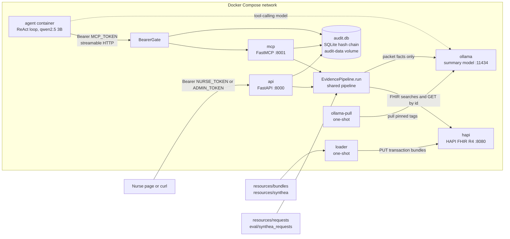
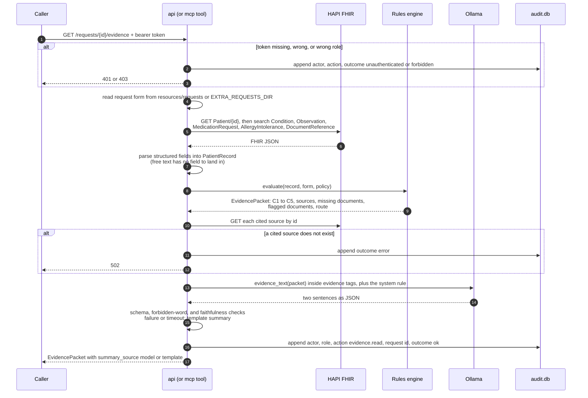

# Data flow

The service has two front doors, the HTTP API and the MCP server, and both call the same `EvidencePipeline.run` in `app/api/pipeline.py`. This page shows the services, the request flow for one evidence packet, and where data is and is not allowed to go.

## Services and front doors

The endpoint never calls the agent (D3). The agent is a client of the MCP server like any other, and the summary model inside the pipeline is a separate call from the agent's own tool-calling model.

## One evidence request

## Where data may go

| Data | Reaches the packet | Reaches the model | Reaches the audit log | Reaches the logs |
|---|---|---|---|---|
| Structured FHIR values (codes, statuses, dates, quantities) | Yes, as rationales, source references, and the `evidence` facts of each criterion | Yes, through `evidence_text` | No | No |
| The member's Patient id | Yes, as a source reference | No | Yes, as `context.subject` on evidence reads, with the resource types and count read | No |
| Free text (`Condition.note`, document attachments, form `notes`) | No | No | No | No |
| Request id and policy id | Yes | The request date only | Yes, as `resource` | No, only a per-call request id |
| Caller identity | No | No | Actor and role | No |
| Timings and summary trace | Yes, as `trace` | No | Yes, as `context.duration_ms` and `context.summary` | Only per-call `duration_ms` and the fallback reason |
| Model output | As `summary`, after the checks pass | Not applicable | No | No, only the exception type on fallback |
